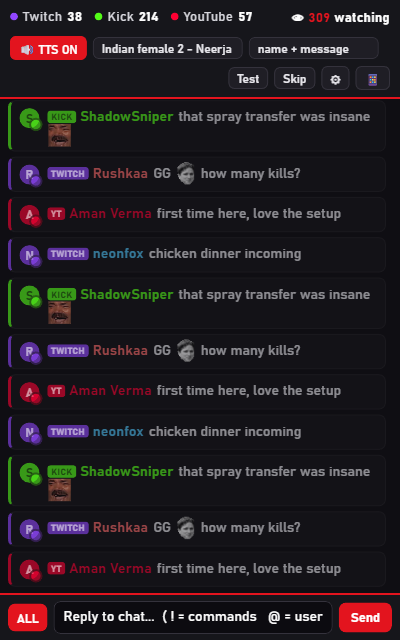
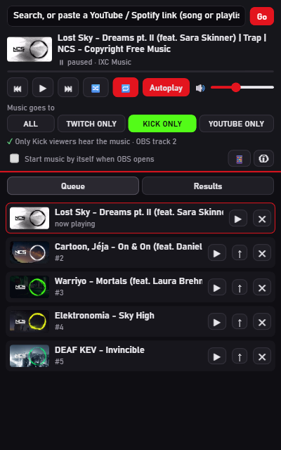
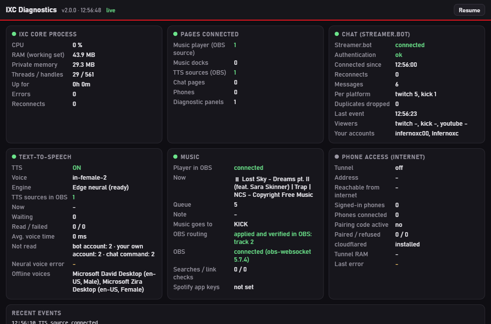
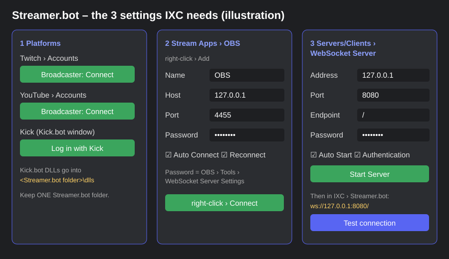
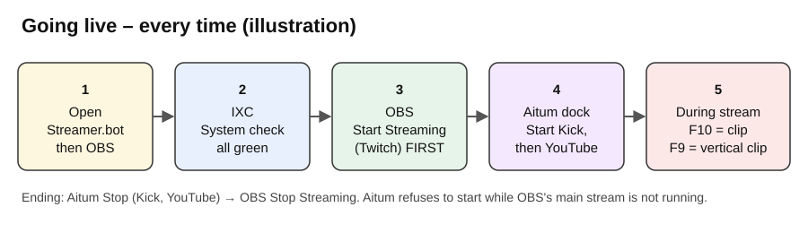

# First-time setup: OBS + IXC + Streamer.bot + Aitum Multistream

For people who have **never** used OBS, IXC or Streamer.bot. Follow the parts in order. Every click is written out.
Time needed: about 45 minutes the first time. You never need to create developer apps or client IDs.

| Program | What it does for you |
|---|---|
| **OBS Studio** | Captures your game, camera and sound, encodes the video and sends it to the platforms |
| **Aitum Multistream** (OBS plugin) | Sends the same video to more platforms at once (e.g. Kick and YouTube next to Twitch) |
| **IXC** | Chat box for all platforms, music player, chat voice, commands, timers, replay clips, system check |
| **Streamer.bot** | Holds your Twitch / YouTube / Kick sign-ins so IXC can reply in chat, and runs automations |

> **Never share your stream keys.** Paste them only into the OBS / Aitum fields named below. Nobody (including IXC support or
> an AI helper) needs to see them.

---

## Part 1 – OBS Studio (10 min)

1. Download OBS Studio 30 or newer from **obsproject.com** > **Windows** > run the installer > **Next** until **Finish**.
2. Open OBS once. If the **Auto-Configuration Wizard** appears: choose **Optimize for streaming** > **Next** > keep the
   resolution **1920x1080** and **60 FPS** > **Next** > **Skip** the service step (we set it in Part 4) > **Apply Settings**.
3. **Settings** (bottom right) > **Output** > **Output Mode: Advanced** > tab **Streaming**:
   - **Video Encoder**: your graphics card's hardware encoder: *AMD HW H.264 (AVC)* (AMD), *NVIDIA NVENC H.264* (NVIDIA)
     or *QuickSync H.264* (Intel).
   - **Rate Control: CBR**, **Bitrate: 6000** Kbps (Twitch's usual limit; Kick allows up to 8000), **Keyframe Interval: 2 s**,
     **Preset: Quality**.
   - **Audio Track: 1**.
4. Same window > **Output** > tab **Recording**: **Recording Path**: a folder with free space (e.g. `D:\OBS\Recordings`),
   **Video Encoder: (Use stream encoder)**.
5. **Output** > tab **Replay Buffer**: tick **Enable Replay Buffer**, **Maximum Replay Time: 120** s.
6. **General** > tick **Automatically start replay buffer when streaming**.
7. **Hotkeys** > find **Save Replay** > click the box > press **F10**.
8. **Tools** > **WebSocket Server Settings** > tick **Enable WebSocket server**, port **4455**, tick **Enable Authentication**
   > **Show Connect Info** > note the password (IXC finds it by itself; Streamer.bot needs it in Part 3) > **OK**.
9. Click **OK**, then **File > Exit** (IXC adds its panels while OBS is closed).

## Part 2 – IXC (5 min)

1. Open the IXC release page on GitHub > **Assets** > download **`IXC-Setup-v….exe`** (or the ZIP and run `Install.bat`).
2. Run it. **"Windows protected your PC"?** **More info** > **Run anyway** (IXC has no paid certificate; the checksum is in
   `SHA256SUMS.txt`). Choose **Express setup**.
3. The **setup assistant** opens in your browser: enter your channel names (Twitch name, YouTube @handle, Kick name) > it sets up
   OBS and tests everything.
4. Open OBS: menu **Docks** shows **IXC**, **IXC ChatBox**, **IXC Music**. Tick them and drag them where you like.

    
5. In the IXC dashboard (tray icon bottom right > **Open**) > **Updates & diagnostics** > **System check**: everything should be
   green. If something is red, press its **Fix** button.

   

## Part 3 – Streamer.bot (download, sign in, connect to OBS and IXC)

**Download and start**
1. Go to the official site **[streamer.bot](https://streamer.bot)** > **Download** > download the ZIP.
2. Right-click the ZIP > **Extract All…** > choose a folder you keep, for example **`C:\Streamer.bot`** (not Downloads).
   ⚠ Keep **only one** Streamer.bot folder. Two copies cause confusion (updates land in the wrong one).
3. Open that folder > double-click **`Streamer.bot.exe`**. If Windows asks, **More info** > **Run anyway**.

**Sign in to your platforms**

4. **Twitch**: **Platforms** > **Twitch** > **Accounts** > **Broadcaster Account** > **Connect** > log in to Twitch in the browser >
   **Authorize**. Optional: a second Twitch account for a chat bot under **Bot Account** > **Connect**.
5. **YouTube**: **Platforms** > **YouTube** > **Accounts** > **Broadcaster** > **Connect** > choose your Google account >
   **Allow**.
6. **Kick** (needs the free **Kick.bot** extension):
   - Download the latest **`Kick.bot-vX.Y.Z.zip`** from the Kick.bot project page.
   - Close Streamer.bot. Open the ZIP and copy **all its `.dll` files** (Kick.bot.dll, PusherClient.dll, WebSocket4Net.dll, …)
     into the **`dlls`** folder **inside your Streamer.bot folder** (e.g. `C:\Streamer.bot\dlls`). Replace existing files.
   - Start Streamer.bot again. In the **Kick.bot** window, log in with your Kick account.
   - A **"Kick.bot – Update available"** window means the `dlls\Kick.bot.dll` that Streamer.bot loads is old. Copy the new ZIP's
     DLLs into **that** `dlls` folder (the one next to the `Streamer.bot.exe` you start).

**Connect Streamer.bot to OBS**

7. **Stream Apps** > **OBS** > right-click in the list > **Add**:
   **Name** `OBS`, **Host** `127.0.0.1`, **Port** `4455`, **Password** = the OBS WebSocket password from Part 1 step 8,
   tick **Auto Connect** and **Reconnect** > **OK** > right-click the entry > **Connect**. Status turns **Connected**.

**Connect Streamer.bot to IXC**

8. **Servers/Clients** > **WebSocket Server**: **Address** `127.0.0.1`, **Port** `8080`, **Endpoint** `/`, tick **Auto Start**,
   tick **Enable Authentication** and type a password > **Start Server**.
9. In IXC: **System** > **Streamer.bot**: **Address** `ws://127.0.0.1:8080/`. IXC reads the password from Streamer.bot's
   settings by itself. If it can't, paste the password from step 8 > **Save**. Press **Test connection**: it shows your accounts.
   **Start with IXC**: **No** (you open Streamer.bot yourself). Now IXC replies in chat through Streamer.bot.

## Part 4 – Twitch, Kick and YouTube at once (10 min)

To keep your PC smooth, the video is encoded **once** (OBS's main stream) and Aitum sends a copy to the other platforms.

1. Install **Aitum Multistream** from **aitum.tv** (installer for your OBS version) with OBS closed. Open OBS: menu **Docks** >
   **Aitum Multistream**.
2. **Main platform** in OBS: **Settings** > **Stream** > **Service: Twitch** > **Connect Account** (sign in) *or* **Use Stream
   Key** and paste the key from Twitch Creator Dashboard > Settings > Stream > **Primary Stream key** > **OK**.
3. Aitum dock > ⚙ **Settings** > **Add output**:
   - **Kick**: Server = *Stream URL* from Kick dashboard > Settings > Stream; Key = *Stream Key* from the same page;
     **Video Encoder: Main Encoder**; **Audio Track: 2**.
   - **YouTube**: Server `rtmps://a.rtmps.youtube.com:443/live2`; Key = YouTube Studio > **Create** > **Go live** > **Stream key**;
     **Video Encoder: Main Encoder**; **Audio Track: 3**.
4. In IXC > **Streams**: Twitch, YouTube and Kick should all say **READY** (keys are never shown, only "set").
5. Music per platform: IXC > **Audio routing**: switch music on for the platforms you want (Twitch = track 1, Kick = 2,
   YouTube = 3).

## Part 5 – Vertical clips (Shorts / TikTok), optional (5 min)

1. Install **Aitum Vertical Canvas** from **aitum.tv** with OBS closed. Open OBS: the **Vertical** dock appears.
2. Vertical dock > ⚙ > **Backtrack**: enable, **Duration 90–120 s**, **Path** e.g. `D:\OBS\Recordings\Vertical`.
3. **Save Backtrack Hotkey**: click the box > press **F9** > **OK**.
4. Backtrack runs while you stream or while the replay buffer runs. **F9** saves the last 90–120 s vertical, **F10** the
   horizontal one.

## Going live (every time)

1. Open **Streamer.bot**, then **OBS** (IXC is already running in the tray).
2. Look at IXC **System check**: all green.
3. OBS: **Start Streaming** (main platform, e.g. Twitch) **first**.
4. Aitum dock: **Start** Kick, then **Start** YouTube (Aitum refuses while the main stream is not running).
5. Check each platform's dashboard shows you live. Press **F10** / **F9** for clips any time.
6. Ending: Aitum **Stop** both, then OBS **Stop Streaming**.

## If something goes wrong

| You see | Do this |
|---|---|
| OBS "Failed to connect to server" | Settings > Stream: the key is empty or wrong. Paste it again from the platform's dashboard. |
| Aitum "main was not started" | Press OBS **Start Streaming** first. |
| Laggy stream, GPU 100 % | Make sure Kick/YouTube use **Main Encoder** (one encode), not their own encoder. |
| IXC panels show "click here to retry" | IXC > Settings > **Start and stop with OBS: off** (IXC then starts with Windows). |
| "OBS has no source called IXC Music Player" | IXC > System check > **Repair OBS** (3.3.0 also follows renamed sources). |
| Kick.bot "Update available" window | Click **Update** in that window. |
| Streamer.bot keeps reopening | IXC > Streamer.bot > **Start with IXC: No**. |

More help: [GUIDE.md](GUIDE.md) · [TROUBLESHOOTING.md](TROUBLESHOOTING.md)
