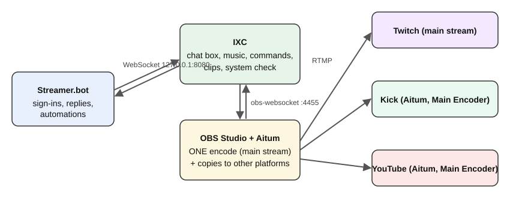
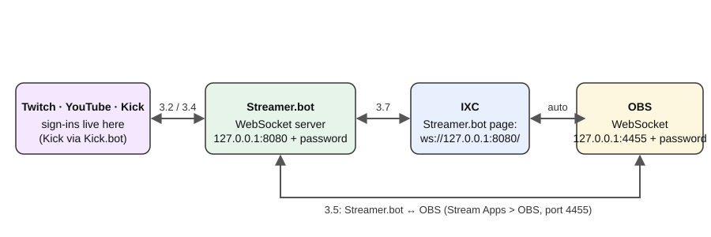
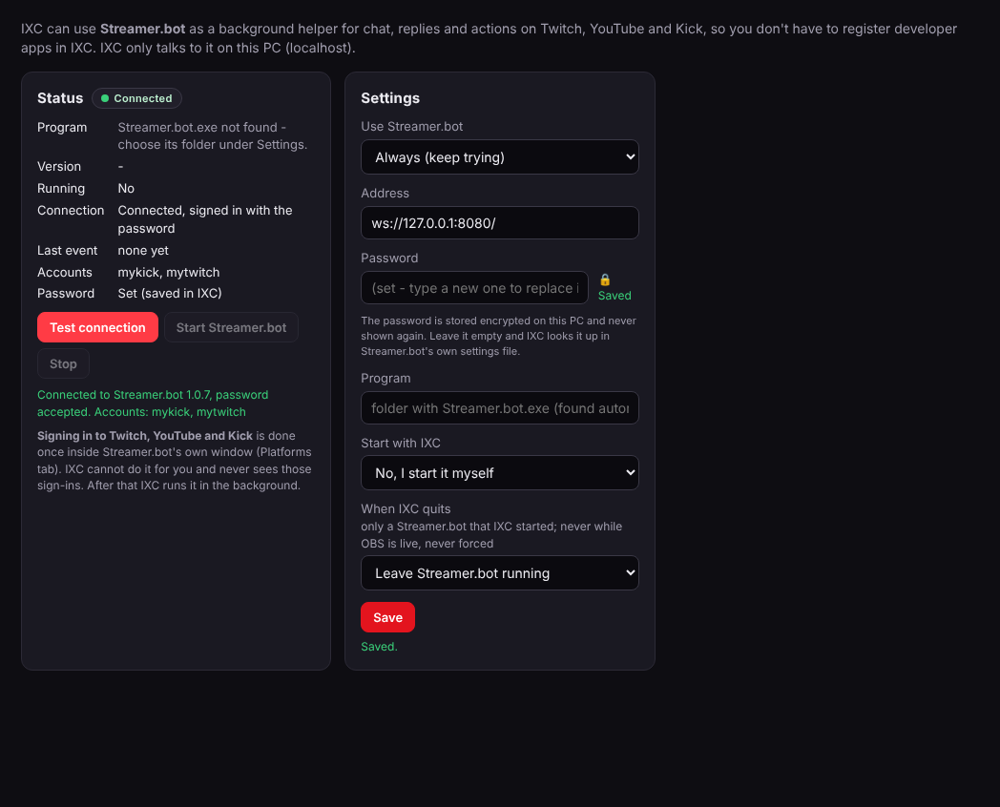
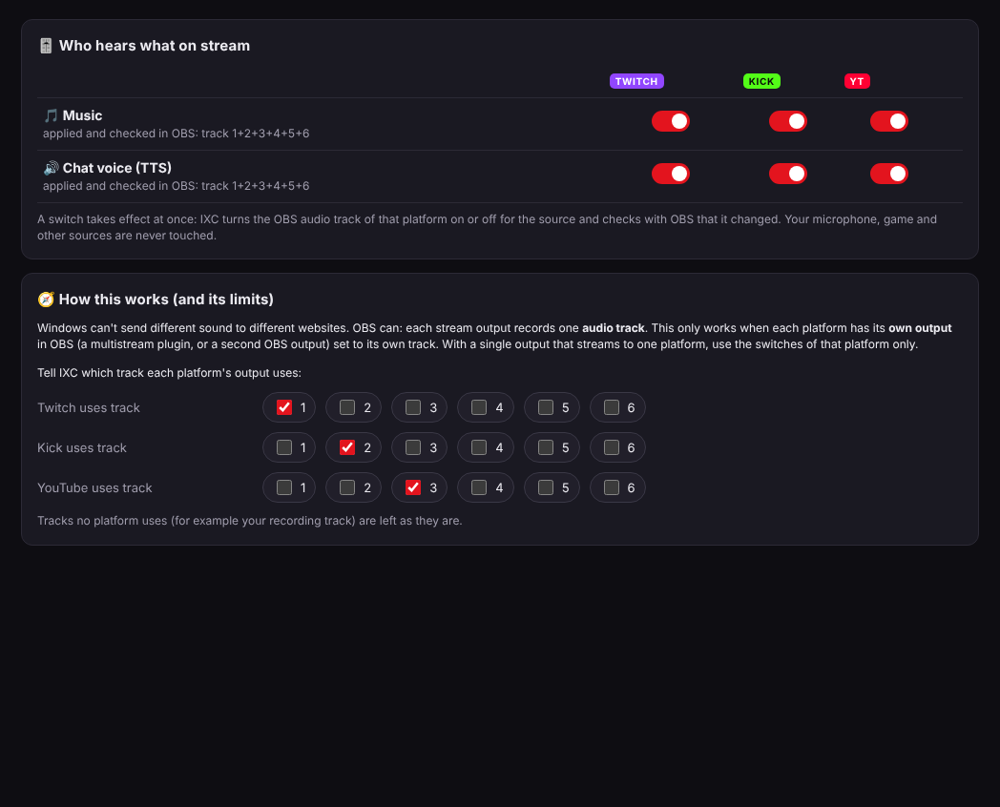

# First-time setup: OBS + IXC + Streamer.bot + Aitum Multistream

For people who have **never** used OBS, IXC or Streamer.bot. Follow the parts in order. Every click is written out.
Time needed: about 45 minutes the first time. You never need to create developer apps or client IDs.

**Before you start:** to stream to three sites at once you need about **25 Mbit/s of free upload** (your stream is sent three times).
Test at speedtest.net and look at *Upload*. If it is lower, use a lower bitrate in Part 1 step 3 or stream to fewer sites.

**About the pictures:** the IXC screenshots use demo data (example account names). OBS, Streamer.bot and Aitum have their own windows
that look a little different in every version, so for those the steps name the exact menu and button to click.

| Program | What it does for you |
|---|---|
| **OBS Studio** | Captures your game, camera and sound, encodes the video and sends it to the platforms |
| **Aitum Multistream** (OBS plugin) | Sends the same video to more platforms at once (e.g. Kick and YouTube next to Twitch) |
| **IXC** | Chat box for all platforms, music player, chat voice, commands, timers, replay clips, system check |
| **Streamer.bot** | Holds your Twitch / YouTube / Kick sign-ins so IXC can reply in chat, and runs automations |

> **Never share your stream keys.** Paste them only into the OBS / Aitum fields named below. Nobody (including IXC support or
> an AI helper) needs to see them.

---

## Part 1 – OBS Studio (10 min)

1. Download OBS Studio 30 or newer from **obsproject.com** > **Windows** > run the installer > **Next** until **Finish**.
2. Open OBS once. If the **Auto-Configuration Wizard** appears: choose **Optimize for streaming** > **Next** > keep the
   resolution **1920x1080** and **60 FPS** > **Next** > **Skip** the service step (we set it in Part 4) > **Apply Settings**.
3. **Settings** (bottom right) > **Output** > **Output Mode: Advanced** > tab **Streaming**:
   - **Video Encoder**: your graphics card's hardware encoder: *AMD HW H.264 (AVC)* (AMD), *NVIDIA NVENC H.264* (NVIDIA)
     or *QuickSync H.264* (Intel).
   - **Rate Control: CBR**, **Bitrate: 6000** Kbps (a safe value for Twitch; if you have the upload speed and Twitch plays smoothly for viewers, 8000 also works,
     and Kick and YouTube accept it), **Keyframe Interval: 2 s**,
     **Preset: Quality**.
   - **Audio Track: 1**.
4. Same window > **Output** > tab **Recording**: **Recording Path**: a folder with free space (e.g. `D:\OBS\Recordings`),
   **Video Encoder: (Use stream encoder)**.
5. **Output** > tab **Replay Buffer**: tick **Enable Replay Buffer**, **Maximum Replay Time: 120** s.
6. **General** > tick **Automatically start replay buffer when streaming**.
7. **Hotkeys** > find **Save Replay** > click the box > press **F10**.
8. **Tools** > **WebSocket Server Settings** > tick **Enable WebSocket server**, port **4455**, tick **Enable Authentication**
   > **Show Connect Info** > note the password (IXC finds it by itself; Streamer.bot needs it in Part 3) > **OK**.
9. Click **OK**, then **File > Exit** (IXC adds its panels while OBS is closed).

## Part 2 – IXC (5 min)

1. Open the IXC release page on GitHub > **Assets** > download **`IXC-Setup-v….exe`** (or the ZIP and run `Install.bat`).
2. Run it. **"Windows protected your PC"?** **More info** > **Run anyway** (IXC has no paid certificate; the checksum is in
   `SHA256SUMS.txt`). Choose **Express setup**.
3. The **setup assistant** opens in your browser: enter your channel names (Twitch name, YouTube @handle, Kick name) > it sets up
   OBS and tests everything.
4. Open OBS: menu **Docks** shows **IXC**, **IXC ChatBox**, **IXC Music**. Tick them and drag them where you like.
5. In the IXC dashboard (tray icon bottom right > **Open**) > **Updates & diagnostics** > **System check**: everything should be
   green. If something is red, press its **Fix** button.

## Part 3 – Streamer.bot (20 min)

**What Streamer.bot is for:** it keeps your Twitch, YouTube and Kick sign-ins, so IXC can **reply** in chat, run **commands** and
show **alerts** without you creating developer apps. The chain is: **platforms ⇄ Streamer.bot ⇄ IXC**, and Streamer.bot ⇄ **OBS**
(so Streamer.bot can switch scenes and see when you go live).

| Connection | Address | Password |
|---|---|---|
| Streamer.bot → OBS | `127.0.0.1` port `4455` (OBS's WebSocket server, Part 1 step 8) | OBS's WebSocket password |
| IXC → Streamer.bot | `ws://127.0.0.1:8080/` (Streamer.bot's WebSocket server, step 3.6) | Streamer.bot's WebSocket password |
| IXC → OBS | `127.0.0.1` port `4455` | IXC finds it by itself |

> These passwords are **not** your platform passwords and **not** stream keys. They only protect the connections on your own PC.

### 3.1 Download and install Streamer.bot

1. Open **streamer.bot** in your browser and click **Download**. Save the ZIP (for example `Streamer.bot-x64-1.0.7.zip`).
2. Open your **Downloads** folder, right-click the ZIP > **Extract All…** > choose a folder you will keep, for example
   `C:\Streamer.bot` (not the Downloads folder) > **Extract**.
3. **Keep only ONE Streamer.bot folder.** If you ever download it again, delete the old folder first (two copies cause confusing
   problems, for example a Kick.bot update that "doesn't stick").
4. Open the folder and double-click **Streamer.bot.exe**. If Windows asks about the firewall, choose **Private networks** > **Allow
   access**. Streamer.bot opens; its folder contains a `dlls` folder (you need it in 3.4).

### 3.2 Sign in to Twitch and YouTube

1. In Streamer.bot open the **Platforms** tab.
2. **Twitch:** click **Twitch** > **Accounts** > **Broadcaster** > **Connect**. Your browser opens: sign in to Twitch and click
   **Authorize**. Streamer.bot then shows your channel name. (Optional: **Bot** > **Connect** for a second chat-bot account.)
3. **YouTube:** click **YouTube** > **Accounts** > **Broadcaster** > **Connect**. Sign in with the Google account of your channel and
   click **Allow**.
4. Streamer.bot's own window walks you through each sign-in; the exact button names can differ slightly between versions.

### 3.3 Why Kick needs an add-on (Kick.bot)

Streamer.bot talks to Kick through a free add-on called **Kick.bot**. It is a ZIP of files that you copy into Streamer.bot's `dlls`
folder.

### 3.4 Install Kick.bot

1. Close **Streamer.bot** (File > Exit, or the window's ✕).
2. Download the Kick.bot ZIP from the Kick.bot project's own page (search for *Kick.bot for Streamer.bot*, and make sure you use the
   project's own link). The file is named like `Kick.bot-v1.2.0.1.zip`.
3. Right-click the ZIP > **Extract All…** > **Extract**.
4. Copy **all the files from the extracted folder** (`Kick.bot.dll`, `PusherClient.dll`, `WebSocket4Net.dll`,
   `SuperSocket.ClientEngine.dll`, and the other `.dll` files; also `actions.txt`) into the **`dlls`** folder inside **your Streamer.bot
   folder**. If Windows asks **Replace the files in the destination**, choose that.
5. Open **Streamer.bot.exe** again.
6. **The "Kick.bot – Update available" window:** if it appears, your `dlls\Kick.bot.dll` is older than the newest version. Copy the
   newest files into the **`dlls` folder of the Streamer.bot you actually run** (see 3.1 step 3), then restart Streamer.bot. It must
   say *No update available* in Streamer.bot's log (the **Log** tab).
7. **Log in to Kick:** use Kick.bot's own window or Streamer.bot's **Platforms > Kick** tab (this appears once Kick.bot is installed),
   click **Connect** or **Login**, and sign in to Kick in the browser. The Streamer.bot log should then say
   *Connected as <your Kick name>*.

### 3.5 Connect Streamer.bot to OBS

1. In **OBS**: **Tools** > **WebSocket Server Settings** > tick **Enable WebSocket server**, **Server Port: 4455**, tick **Enable
   Authentication**, click **Show Connect Info** and note the **Server Password** > **OK**.
2. In **Streamer.bot**: open **Stream Apps** > **OBS**. Right-click the list > **Add** (or **Add Connection**).
3. Fill in: **Name:** `OBS`, **Host:** `127.0.0.1`, **Port:** `4455`, **Password:** the OBS Server Password, tick **Auto Connect** and
   **Reconnect**.
4. Click **OK** and then **Connect**. It must show **Connected** (OBS must be open).

### 3.6 Switch on Streamer.bot's WebSocket server (this is the door IXC uses)

1. In Streamer.bot open **Servers/Clients** > **WebSocket Server**.
2. **Address:** `127.0.0.1` (only your own PC), **Port:** `8080`, **Endpoint:** `/`.
3. Tick **Auto Start**. Tick **Authentication** and type a **password** you will remember. Write it down on paper.
4. Click **Start Server** (and **Save** if the window has that button). The server must show as running.

### 3.7 Connect IXC to Streamer.bot

1. Open IXC (tray icon bottom right > **Open**) > left menu **System** > **Streamer.bot**.
2. **Use Streamer.bot:** *Automatically, when it is running*.
3. **Address:** `ws://127.0.0.1:8080/`
4. **Password:** the one from 3.6. (You can also leave the box empty; IXC then reads it from Streamer.bot's own settings file.)
5. **Start with IXC:** *No, I start it myself*. **When IXC quits:** *Leave Streamer.bot running*.
6. Click **Save**, then **Test connection**.

What you should see (demo data):

The **Status** pill is green **Connected**, and *Connected to Streamer.bot 1.x, password accepted* lists your Twitch / Kick account names.

| If you see | Do this |
|---|---|
| *Not running* / connection refused | Start Streamer.bot, then **Servers/Clients > WebSocket Server > Start Server**. |
| *refused the password* | The password in IXC and in Streamer.bot differ. Type it again in IXC and **Save**. |
| Warning: *WebSocket Server is switched off* | Tick **Auto Start** in Streamer.bot's WebSocket Server and start it (3.6). |
| Warning: *listens on ..., not only on this PC* | Set Streamer.bot's WebSocket address to `127.0.0.1` (3.6). |
| *No platform account reported* | Sign in on Streamer.bot's **Platforms** tab (3.2 and 3.4). |
| Kick shows no events | Kick.bot is old or in the wrong folder (3.4), or you are not logged in to Kick there. |

### 3.8 Check the whole chain

1. OBS is open. Streamer.bot: **Stream Apps > OBS** shows **Connected**.
2. Streamer.bot's **Log** tab: *Connected as …* for Twitch and Kick; the WebSocket server is running.
3. IXC > **Streamer.bot**: green **Connected**, accounts listed. IXC > **Chat**: write a test message in your own chat and see it
   appear in IXC.

## Part 4 – Twitch, Kick and YouTube at once (10 min)

To keep your PC smooth, the video is encoded **once** (OBS's main stream) and Aitum sends a copy to the other platforms.

1. Install **Aitum Multistream** from **aitum.tv** (installer for your OBS version) with OBS closed. Open OBS: menu **Docks** >
   **Aitum Multistream**.
2. **Main platform** in OBS: **Settings** > **Stream** > **Service: Twitch** > **Connect Account** (sign in) *or* **Use Stream
   Key** and paste the key from Twitch Creator Dashboard > Settings > Stream > **Primary Stream key** > **OK**.
3. Aitum dock > ⚙ **Settings** > **Add output**:
   - **Kick**: Server = *Stream URL* from Kick dashboard > Settings > Stream; Key = *Stream Key* from the same page;
     **Video Encoder: Main Encoder**; **Audio Track: 2**.
   - **YouTube**: Server `rtmps://a.rtmps.youtube.com:443/live2`; Key = YouTube Studio > **Create** > **Go live** > **Stream key**;
     **Video Encoder: Main Encoder**; **Audio Track: 3**.
4. In IXC > **Streams** (menu, under *Platforms & Accounts*): Twitch, YouTube and Kick should all say **READY** (keys are never
   shown, only "set"). **READY does not prove your stream arrives**; that only shows when you are live (see *Going live*, step 5).
5. Music per platform: IXC > **Audio routing**: under *How this works* tick the track each site uses (Twitch = track 1, Kick = 2,
   YouTube = 3), then switch music and chat voice on for the platforms you want. A switch takes effect at once and IXC checks with OBS
   that it changed. Music is silent on a site you switch off (useful against a copyright strike on one platform).

   Also put your game and microphone on tracks **1, 2 and 3** (OBS > **Edit > Advanced Audio Properties**), so every site hears them.

## Part 5 – Vertical clips (Shorts / TikTok), optional (5 min)

1. Install **Aitum Vertical Canvas** from **aitum.tv** with OBS closed. Open OBS: the **Vertical** dock appears.
2. Vertical dock > ⚙ > **Backtrack**: enable, **Duration 90–120 s**, **Path** e.g. `D:\OBS\Recordings\Vertical`.
3. **Save Backtrack Hotkey**: click the box > press **F9** > **OK**.
4. Backtrack runs while you stream or while the replay buffer runs. **F9** saves the last 90–120 s vertical, **F10** the
   horizontal one.

## Going live (every time)

1. Open **Streamer.bot**, then **OBS** (IXC is already running in the tray).
2. Look at IXC **System check**: all green.
3. OBS: **Start Streaming** (main platform, e.g. Twitch) **first**.
4. Aitum dock: **Start** Kick, then **Start** YouTube (Aitum refuses while the main stream is not running).
5. Check each platform's dashboard shows you live, with picture and sound, and that OBS (bottom right) shows dropped and skipped
   frames near **0%**. If it is red, lower the bitrate and restart. Press **F10** / **F9** for clips any time.
6. Ending: Aitum **Stop** both, then OBS **Stop Streaming**.

## If something goes wrong

| You see | Do this |
|---|---|
| OBS "Failed to connect to server" | Settings > Stream: the key is empty or wrong. Paste it again from the platform's dashboard. |
| Aitum "main was not started" | Press OBS **Start Streaming** first. |
| Laggy stream, GPU 100 % | Make sure Kick/YouTube use **Main Encoder** (one encode), not their own encoder. |
| IXC panels show "click here to retry" | IXC > Settings > **Start and stop with OBS: off** (IXC then starts with Windows). |
| "OBS has no source called IXC Music Player" | IXC > System check > **Repair OBS** (3.3.0 also follows renamed sources). |
| Kick.bot "Update available" window | Click **Update** in that window. |
| Streamer.bot keeps reopening | IXC > Streamer.bot > **Start with IXC: No**. |
| Kick or YouTube does not start in Aitum | Press OBS **Start Streaming** first, then start them in the Aitum dock. |
| `!clip` or F10 saves nothing | Start the **Replay Buffer** (OBS Controls panel, or tick *Automatically start replay buffer when streaming*). |
| Anything else | IXC > **Updates & diagnostics > Diagnostics** makes a ZIP for support (no passwords or keys inside). |

**Not covered by automatic tests:** whether each platform really receives your stream. That needs your real accounts and keys, which
tests never use. Your first live minute is that test.

More help: [GUIDE.md](GUIDE.md) · [TROUBLESHOOTING.md](TROUBLESHOOTING.md)
